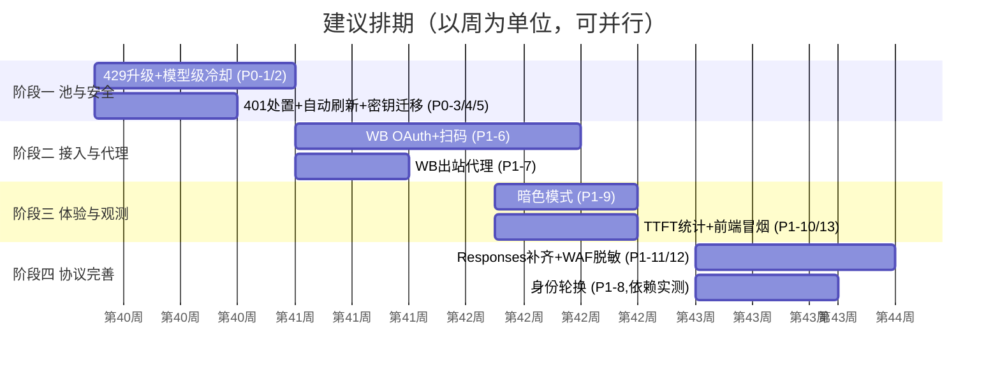

# RelayGate 升级规划（2026-10-04）

> **依据**：`docs/06-deliverables/comparisons/wb-ecosystem-comparison-2026-10-04.md` 及其增补勘误（下称"对比报告"）、`docs/06-deliverables/comparisons/workbuddy-comparison-report.md`，以及本次对活跃仓库的代码核验（文中引用均为当前实况的 `文件:行号`）。
>
> **定位**：规划文档，不含代码改动。所有优先级、工作量均为建议值，执行时应结合当时上游协议状态与实际使用场景重新确认。

---

## 0. 现状基线（规划出发点）

| 领域 | 已具备（核验属实） | 明确缺口 |
|---|---|---|
| 账号池 | 多平台统一池（Trae+WB）、`least_balance` 多层比较器：priority→FEFO d3/d7→costTier→余额→闲置（`pool.js:344-378`）、请求级轮换 maxSwitches=3（`pool.js:476`）、粘性会话、FIFO 背压+精确唤醒、分组/编辑/置顶、设备指纹重置 deviceGen（`import.js:273`） | 模型级冷却、429 指数退避与恢复时间解析、加权随机打散热点、账号健康度量化呈现 |
| OAuth/登录 | Trae OAuth 完整闭环（本机回调 17388 + SSRF 白名单 `oauth.js:34-38` + 三信封兼容）；WB 本机登录态抓取 + info 粘贴导入（含 `$wbEncrypted` 防御 `workbuddy/auth.js`） | WB OAuth 浏览器授权、扫码登录、OAuth 状态的失败重试与过期提醒 UI |
| 限流处置 | 账号级固定 20s 冷却（`config.js:136`）、出站节流 minPickGap、滚动窗口槽位 | 模型级冷却、精确恢复时间、指数退避、WAF 级识别 |
| 安全 | AES-256-GCM 落库、CSP 中间件、SSRF 白名单、路由兜底、ErrorBoundary | 登录密钥存 localStorage（`useAuth.ts:5`）、WB 通道无出站代理 |
| 前端 | 设计令牌化（tailwind.config 完整语义色）、SetupGate、真实 URL 子栏、WhoTag 语义表、盲区诚实标注 | 移动端零适配（Sidebar 固定 `w-52`，`Sidebar.tsx:27`）、无暗色、无自动刷新、401 无全局处置、无前端测试 |

---

## 1. 多账号池系统建设

### 1.1 设计原则

现有池的骨架（比较器选号 + 请求级轮换 + 背压）已经健康，升级倾向于**在既有 `pickCandidate` 过滤链上做增量**，而非重构调度模型。核心思路：把"账号是否可用"从布尔判断升级为「**约束集 + 分数**」两段式——约束集决定资格（现有过滤项不变），分数决定排序（新增维度可插拔）。

### 1.2 功能项设计

#### A. 模型级冷却（优先级最高，来源：hub `model_cooldowns` / panel 模型豁免）

- **现状问题**：`pool.js:441` 的 rate_limit 记录冷整账号；实际 429 通常是「账号 × 模型」粒度（某模型限免到期，其余模型不受影响）。
- **设计**：
  - 账号增加 `modelCooldowns: { [model]: coolUntilISO }` 字段（SQLite 加列，JSON 存储即可，规模小）。
  - `record(accountId, 'rate_limit', { model })` 时按模型写入；`pickCandidate` 增加过滤项 `!modelCooling(a, reqModel)`。
  - 粘性路径同样尊重该过滤（`pool.js:481` 的粘性复用判定补一项）。
  - `/status` 透出冷却明细，前端账号详情弹窗展示「哪些模型在冷却、到几点」。
- **验收**：构造同账号模型 A 429、模型 B 正常的用例（unit 层 mock 上游），断言 B 仍被选中。

#### B. 429 冷却时长升级：恢复时间解析 + 指数退避（来源：hub `parse_rate_limit_reset`、panel `applyErrorPolicy`）

- **设计**：
  - `upstream/errors.js` 新增 `parseRateLimitReset(messageText)`：从上游文案提取精确恢复时刻（hub 实测上游会带 "usage will reset at ..." 类文本）；解析失败走退避。
  - 冷却基数可配置（默认维持 20s 兼容现状），连续 rate_limit 按次数指数递增（20s→40s→80s…封顶 30min，可配）；签到/余额刷新成功视为"解冻信号"提前清除（对齐 panel 的软冷却语义）。
- **兼容性**：`config.js` 的 `rateCooldownMs` 保留作为基数，不破坏既有 env 配置。

#### C. 权重与打散（来源：panel Top-5 加权随机）

- **现状**：`least_balance` 是纯排序，池顶号容易被连续打满（有 minPickGap 节流缓解，但无随机性）。
- **设计**：排序后取前 5 名，按「余额占比 × 10 + 闲置补偿」权重随机抽签；账号表已有 `priority`（硬置顶）保持不变，新增可选 `weight` 字段（0-10，默认 0=不参与加权）。加权仅在比较器无法区分（同层）时生效，避免破坏 FEFO 语义。
- **取舍说明**：panel 采用加权随机是因为其 FEFO 场景弱；本项目 FEFO 是硬语义（临期作废），因此**只对「非临期、同 costTier、余额接近」的候选做打散**，倾向于保守引入。

#### D. WB 通道出站代理槽（来源：hub `proxy_slots`）

- **现状**：Trae 通道有 env 代理（`upstream/client.js:74`），WB 通道 `workbuddy/chat.js` 裸 `fetch`，无 agent。
- **设计**：
  - `src/workbuddy/proxy.js`：读 env（`WB_PROXY_URL`）+ 后续可扩展命名槽位；`https-proxy-agent`/`socks-proxy-agent` 已在依赖中，直接复用 Trae 侧的 agent 单例模式。
  - chat/签到/查积分/目录刷新四条出站统一接 agent；`model-router` 的 openai Provider 同步接入。
  - 阶段二再考虑"槽位命名/启停/绑定账号/出口 IP 探测"的完整形态（hub 已验证价值，但个人场景收益递减）。

#### E. WB 出站身份轮换（来源：hub 三身份，Phase 2 可选）

- `workbuddy/auth.js:33` 固定 UA；建议预置 web/桌面/CLI 三套身份头常量，账号记录 `identityProfile`，429 时随冷却轮换。与 B 联动收益最大，但依赖对上游三身份的实测验证，放在依赖观察之后。

#### F. 账号分类与健康度监控增强

- 已有：分组（groupOk）、edition 区分、错误计数。建议补：
  - 账号行内健康度徽标（正常/冷却中/模型冷却/临期/欠费四态聚合，数据源 `/status` 已基本齐全）；
  - 冷却明细 tooltip（A 项的数据）；
  - 「试跑」按钮：对手动导入的账号做一次目录拉取验证（复用 `wbVerify` 端点），导入后不用等调度器才发现坏号。

### 1.3 不建议引入

- Upstash Redis 镜像（panel）：单进程个人网关场景过重，SQLite 已够。
- 挑号全面改加权随机（panel 原版）：会稀释本项目 FEFO 硬语义，按 1.2-C 的保守方式引入即可。

---

## 2. OAuth 认证与扫码登录

### 2.1 现状与可行性判断

| 平台 | 现状 | 可行路径 |
|---|---|---|
| Trae | OAuth 浏览器授权闭环已完整（回调 127.0.0.1:17388，30 分钟监听窗，SSRF 白名单） | **无需新建**；补扫码 = 把授权入口做成可跨设备访问 |
| WorkBuddy | 无 OAuth；依赖本机桌面端 auth 文件 + info 粘贴 | **需要新建**：两条已验证路径——hub 的浏览器 OAuth 流（`wb_accounts.py:1203` auth/state→authUrl→轮询换 token）；panel 的设备授权三端点（`panel/login.go:118`） |

**扫码登录的技术前提（诚实说明）**：Trae 的 OAuth 回调固定指向 `127.0.0.1:17388`，手机扫码后回调会落在手机本机，直接把授权 URL 生成二维码是**不可用的**。可行设计有两种：

- **方案一（推荐，自托管授权入口页）**：网关新增 `/oauth/trae/start` 页面，二维码编码的是「网关自身的该入口 URL」；手机扫码后在**手机浏览器**完成 Trae 登录，Trae 回调仍指向网关所在主机的公网/局域网地址（需 `HOST=0.0.0.0` + 回调监听绑定对应地址，或经反向代理转发 17388）。改动小，复用全部既有 OAuth 代码，但要求网关地址从手机可达。
- **方案二（设备码轮询式）**：对齐 panel 的 WB 设备授权模式——面板显示设备码 + 授权链接，用户在任意设备完成授权，网关轮询换取 token。对网络拓扑零要求（纯出站轮询），**WB 场景倾向于这个方案**，因为 hub 已验证 WB 支持浏览器授权流且凭证可直接落库。
- **方案三（仿官方扫码协议，manager 路线）**：直接对腾讯登录协议做 `start_login/poll_login`（`manager/services/tencent.py:109`），把官方返回的二维码图直接展示在面板。体验最像官方客户端，但协议逆向深度要求最高、失效风险最大，作为观察项。

### 2.2 功能项设计

#### A. WB OAuth 设备授权登录（P1 核心）

- 后端 `src/workbuddy/oauth.js`：auth/state 生成授权 URL → 前端展示链接（+二维码，方案二形态）→ 轮询端点（面板 2.5s 轮询，对齐 hub `dashboard.html:1081` 的节律）→ 换 token → 复用现有 `importAccount` 落库（enabled 默认 false 的既有防御不变）。
- 安全约束沿用 Trae OAuth 的既有红线：exchange host 白名单（`variant.js:68` 模式扩展到 WB 域）、state 一次性、token 不回显前端。

#### B. Trae 扫码入口（P2，方案一）

- `/oauth/trae/start` 页面 + 二维码生成（前端 `qrcode.react` 或后端 SVG，倾向前端生成，库已在 manager 依赖清单验证过成熟度；本项目若引库建议评估体积，备选 60 行自实现 QR 编码不可取——QR 规范复杂，直接用轻量库）。
- `OauthTraeDialog` 增加「手机扫码」Tab；回调监听支持绑定 `0.0.0.0`（env 开关，默认维持 127.0.0.1 不降安全）。

#### C. OAuth 运维体验补强

- 授权失败/过期的统一提醒：现有通知体系（`notify/index.js` 四渠道）已具备管道，新增 `oauth_expired` 事件类型即可。
- 账号表标注登录方式（oauth / local-file / info-paste），为后续"按登录方式过滤"留数据基础。

---

## 3. 优秀实践与功能补强（同类项目整合清单）

以下为三份报告结论与本次核验后的**最终整合版**，已剔除增补勘误中确认完成/推翻的条目。

### 3.1 P0（建议 1-2 周内，全部为小改动）

| # | 事项 | 来源 | 落点 | 验收标准 |
|---|---|---|---|---|
| 1 | 429 恢复时间解析 + 指数退避 | hub/panel | `upstream/errors.js` + `pool.js` | 单测覆盖解析成功/失败/退避封顶三路径 |
| 2 | 模型级冷却 | hub | `pool.js` + SQLite 加列 | 同账号 A 模型冷却 B 模型可用的单测 |
| 3 | 401 全局处置：管理面收到 401 清空本地密钥并回 SetupGate | hub `panelSessionLost` | `web/src/lib/api.ts` 的 ApiError(401) 分支 | 改密钥后旧 tab 自动回登录引导，不再连续报错 |
| 4 | 管理面自动刷新 + 可见性感知 | manager `useHeartbeat` | Overview 30s 自动刷新 + `document.hidden` 暂停、切回即刷 | 切后台不产生请求（DevTools Network 验证） |
| 5 | 登录密钥迁移出 localStorage | 自审 M-S3 | `useAuth.ts` 改 sessionStorage + 明确"刷新需重登"的产品口径 | 关闭浏览器重开不残留密钥 |

### 3.2 P1（建议一个月内）

| # | 事项 | 来源 | 说明 |
|---|---|---|---|
| 6 | WB OAuth 设备授权 + 扫码 | hub/panel | 本规划 §2.2-A |
| 7 | WB 出站代理 | hub | §1.2-D |
| 8 | WB 身份轮换 | hub | §1.2-E，依赖实测 |
| 9 | 前端暗色模式 | panel | 设计令牌已就绪，主要工作量是 `.dark` 变量组梳理 + 切换器 |
| 10 | 用量统计补 TTFT / tok/s | hub | `log/traffic.js` 加字段，StatsPage 加"模型性能"区块 |
| 11 | Responses 事件族补齐（`response.completed` 收尾 / `output_index` 一致） | manager | Codex 类客户端兼容性 |
| 12 | WAF 出站文本脱敏（默认关闭的开关） | hub | 防 11128 拒流；默认关避免误伤 |
| 13 | 前端冒烟测试 | panel `frontend_test.go` 思路 | Node 脚本对 `web/dist` 做加载与关键函数存在性检查，进 npm test |

### 3.3 P2（观察项，按需启动）

密钥多租户（IP 白名单/有效期/双配额，manager）——分发给第二人时才刚需；积分"日均需耗"可视化（panel）；任务时间预算（auto-signin）；文档站工程化（Guide）；ed25519 验签更新（manager）。

---

## 4. 实施路径规划

### 阶段说明

**阶段一（第 1 周）— 池健壮性与安全收口**
- 资源：单人，纯后端 + 前端小改。
- 范围：P0 全部 5 项。
- 验收：`npm test` 全绿且新增 ≥8 个用例；DevTools 验证后台零轮询请求；改密钥后旧会话正确退出。
- 风险：恢复时间解析依赖上游文案格式，需先抓真实 429 报文确认样例（若文案不含时刻，则该子项降级为纯指数退避）。

**阶段二（第 2-3 周）— 接入升级**
- 资源：单人；WB OAuth 需要一个可用 WB 账号做联调。
- 范围：P1-6/7。
- 验收：全程无桌面端参与完成 WB 账号添加并成功转发一次 chat；代理开关开启后上游侧可见出口 IP 变化（或本地抓包验证 CONNECT）。
- 风险：WB 授权协议为逆向所得，可能随上游改版失效——建议实现时把协议常量集中到一个文件，便于失效后快速修补（对齐 panel/hub 的做法）。

**阶段三（第 3 周，与阶段二部分并行）— 前端体验**
- 范围：P1-9/10/13。
- 验收：暗色下全部页面无对比度缺陷（对照 WCAG AA，`faint #667085` 的浅色基准在暗色下需重定）；统计页出现 TTFT 分布；`npm test` 包含 dist 冒烟。

**阶段四（第 4 周）— 协议完善与观察项**
- 范围：P1-11/12 + 身份轮换（依赖阶段二期间的实测数据决定是否启动）。
- 验收：Codex CLI 直连 `/v1/responses` 完整跑通一轮工具调用；脱敏开关开启时转发文本不含特征串（用例断言）。

### 资源与依赖总览

- 人力：全程可单人推进；阶段二是唯一需要外部条件（可用 WB 账号、真实 429 报文样本）的环节。
- 新增依赖：建议仅 `qrcode.react`（或等价轻量库，评估后定）——其余全部用现有依赖（express/node-fetch/代理 agent）与标准库。
- 每阶段完成后跑一次完整测试三件套并按惯例更新 `CODE_REUSE_LOG.md`。

---

## 5. 前端专项分析：借鉴点与现存问题

### 5.1 值得借鉴的前端实践（按借鉴成本从低到高）

| 借鉴点 | 来源项目 | 本项目吸收方式 |
|---|---|---|
| 空态行动引导：表格空态直接给「添加账号」按钮而非一行灰字 | hub | `AccountsPanel`/`AccessKeysPanel` 空态改造，成本极低 |
| 解锁后才启动轮询/请求 | hub | 与 P0-4 的自动刷新一并设计：`useAuth().key` 为空时不发请求 |
| 401 → 停请求回登录 | hub | P0-3，前端唯一全局错误分支，建议同步处理 403（密钥被禁用） |
| `[data-theme]` 双色板令牌 + `prefers-reduced-motion` | panel | 本项目令牌体系（ink/line/surf/acc）就是为此准备的，暗色 = 换一组变量值；`index.css` 已有 `:focus-visible` 基础 |
| 移动端表格转卡片：`thead` 隐藏 + `td::before{content:attr(data-label)}` + `order` 重排，纯 CSS | hub | `AccountTable.tsx` 加 `md:` 断点即可，无需 JS；账号行字段多，卡片化收益最大 |
| `useHeartbeat`：`visibilitychange` + 切回立即刷 | manager | P0-4 的实现要点 |
| async-state 区分「加载中/空/错误」三态，防骨架屏闪烁 | manager | `useSummary` 目前只有 data/null 两态，建议补 `loading` 态并在首次加载时显示骨架 |
| 前端资源冒烟测试进 CI | panel | P1-13 |
| design-qa 截图回归 + 品牌色贯穿（theme-color、代码高亮、selection 色） | Guide | 低成本高辨识度：`::selection` 用 `acc-soft`、`theme-color` meta 已有可对齐 |

### 5.2 本项目前端设计不合理/疏漏清单（逐项核对过代码）

**结构性问题**

1. **移动端零适配（最严重）**。`Sidebar.tsx:27` 固定 `w-52` + `Layout.tsx:8` `flex h-screen`，无任何 `md:/lg:` 断点；390px 宽度下主区被压成竖条（此前实测截图已确认）。表格 `min-w` 横向滚动是唯一降级手段。建议：`≤lg` 隐藏侧栏改顶栏汉堡抽屉（Sidebar 状态提入 Layout），表格按 hub 的纯 CSS 卡片化方案处理。
2. **无自动刷新**。管理面所有数据靠手动刷新或操作后 1.2s 拉取（`Overview.tsx:143`）。对"常驻观察调度链"的定位来说，执行链卡片的 last/next 时间戳几乎总是陈旧的。建议 P0-4 方案。
3. **401/403 无全局处置**。`api.ts:33` 只抛 `ApiError`，各页面 `.catch(() => setStatus(null))` 各自吞掉（如 `Overview.tsx:53`），密钥失效后用户看到的是"数据全空"而不是"请重新登录"。建议全局分支 + SetupGate 复用。

**安全疏漏**

4. 登录密钥明文 localStorage（`useAuth.ts:5,14`）——XSS 场景下密钥可被读走；CSP 已收紧（`script-src 'self'`）是有效缓解，但存储层迁移 sessionStorage 成本更低、更稳。

**可用性细节**

5. **无加载三态**：`useSummary` 无 loading 态，首次进入与"确实没有数据"在视觉上无法区分（空数组与 null 都渲染空态）。
6. **无暗色**：常驻后台的运维面板，夜间查看是高频场景；令牌体系已就绪，属于"欠一个变量组"而非"欠一套设计"。
7. **前端零测试**：`web/package.json` scripts 无 test；ErrorBoundary 已挂但无任何测试覆盖其触发路径。建议 P1-13 的冒烟方案起步，暂不建议上 vitest 全家桶（组件少，收益低）。
8. **长任务无反馈**：手动触发调度动作后依赖 1.2s 后刷新来体现结果（`Overview.tsx:142-147`），执行失败仅 toast；"成长中心自动化"这类分钟级任务建议在执行链卡片上做进行中态（spinner + 预计耗时），数据源 `/status` 已有。

**做得好、应保持的**（避免升级时被"顺手"破坏）

- 设计令牌纪律（tailwind.config 完整语义色 + WCAG AA 注释）、组件类复用（`.btn/.field/.card/.pill`）；
- 真实 URL 子栏 + Navigate 兜底、SetupGate 首登引导、密钥仅显示一次；
- WhoTag/OPS 语义表与"Token 盲区诚实标注"——这是内容层独有优势，同类项目都没有；
- ErrorBoundary 挂根节点、CSP 无 unsafe-inline script。

### 5.3 前端升级的落地顺序建议

先做**行为层**（P0-3/4/5，小改动大收益），再做**响应式**（移动端卡片化 + 侧栏抽屉，一次集中改 Layout/AccountTable），最后做**主题层**（暗色变量组）。这个顺序的原因：行为层改动小且独立；响应式会触碰几乎所有页面容器，宜一次成型避免反复；主题层依赖令牌梳理，放最后不阻塞其他工作。

---

## 6. 需求覆盖对照

| 需求项 | 对应章节 |
|---|---|
| 多账号池（添加/分类/状态监控/自动切换/权重） | §1（分类=既有分组增强 F，切换=既有轮换+A/B 强化，权重=1.2-C） |
| OAuth 与扫码登录 | §2（含三种扫码方案的可行性裁决） |
| 优秀实践整合（UX/性能/安全） | §3 + §5.1 |
| 分阶段实施（优先级/时间/资源/验收） | §4 |
| 前端借鉴与设计疏漏 | §5 |
